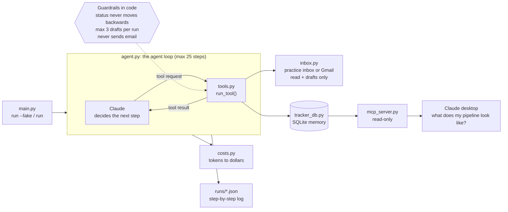

# Job Application Tracker Agent

An AI agent that reads your inbox every morning, keeps a tracker of every job application
(applied → assessment → interview → offer / rejected), ignores the noise, and drafts polite
follow-ups for applications that have gone quiet. It **never sends email**. Drafts wait for you.

<p align="center"></p>

**Highlights**
- Agent loop written by hand (no framework), with guardrails enforced in code, not just in the prompt
- Evaluated against a labeled practice inbox: every run so far scored 100%, on both Sonnet 5.5 and Haiku 5.5 ([results](results/README.md))
- Prompt caching cut the cost per run by about 40% (input-token cost by about 60%) with no change in accuracy ([experiment](results/README.md#prompt-caching-experiment-2026-11-26))
- Every run saves a step-by-step JSON log of each model decision and tool call
- A read-only MCP server lets the Claude desktop app answer questions like "what does my pipeline look like?"

## Why this is an agent and not a chatbot

| A chatbot... | This agent... |
|---|---|
| can't see your inbox | searches and reads your Gmail |
| gives you text; you do the work | updates a database and saves drafts itself |
| only runs when you type | runs on a schedule while you sleep |
| forgets everything | remembers every application in SQLite |
| follows one fixed script | decides which emails to read, what to search, what to skip |

---

## Quick start (practice mode, about 10 minutes)

Practice mode uses `sample_data/fake_inbox.json`, which has 12 made-up emails from fictional
companies, including some traps. You don't need Google set up for this.

**1. Get an Anthropic API key.** Sign in at console.anthropic.com, open API Keys, create a key, and add a
few dollars of credit. A practice run costs well under a cent on Haiku and a few cents on Sonnet
(the agent prints the exact cost at the end).

**2. Run the setup script** (Mac/Linux, needs Python 3.10+). It creates a virtual environment, installs
the libraries, asks for your key (saved to `.env`, which git ignores), and runs the tests.
```bash
./setup.sh
source .venv/bin/activate
```
On Windows: `python -m venv .venv`, `.venv\Scripts\activate`, `pip install -r requirements.txt`, then
create a file named `.env` containing `ANTHROPIC_API_KEY=sk-ant-...`.

The model defaults to Sonnet 5.5. To use another one, add a line like `AGENT_MODEL=claude-haiku-5-5` to `.env`.

**3. Check the tools work (no AI, free)**
```bash
python -m unittest discover tests
```

**4. Run the agent**
```bash
python main.py run --fake
```
Watch the log. Each `step N: tool_name(...)` line is the model choosing an action.
Drafts appear in the `drafts/` folder. The last lines show the cost and where the full
step-by-step log was saved (`runs/`). Run it again and notice it skips everything,
because it remembers what it already processed.

**5. Start over any time:** `python main.py reset --fake`

### Results: model comparison (Nov 16, 2026, sample inbox, 1 run each)

| | Sonnet 5.5 | Haiku 5.5 |
|---|---|---|
| Statuses correct | 6/6 | 6/6 |
| Noise skipped | 3/3 | 3/3 |
| Follow-up drafts | 1/1 | 1/1 |
| Tried to move Harbor Capital backwards? | Yes, blocked by code guardrail | Yes, blocked by code guardrail |
| Steps | 8 | 7 |
| Tokens (input + output) | 65,118 + 4,107 | 48,974 + 4,751 |
| Cost per run | ~$0.17 | ~$0.007 |

**What I learned:** on this test set, the cheaper model matched the larger one's accuracy at about
4% of the cost. Both models broke the same prompt rule ("statuses never move backwards"), and the
check in `tracker_db.py` stopped both, which is why guardrails belong in code. One run each is a small
sample; next step is repeated runs with an automated eval.

All runs, logs and the prompt caching experiment are in [results/](results/README.md).

### What a correct practice run looks like
Use this to check the agent's work. It's your first **evaluation set**.

| Company | Role | Expected status | Follow-up draft? |
|---|---|---|---|
| Skyline Airways | Sales Strategy & Pricing Intern | applied | No (noreply address; should mention in summary) |
| Northbridge Consulting | Data Analyst Intern | applied | **Yes**, to priya.shah@northbridge.example (stale, 20 days) |
| Northbridge Consulting | Strategy Consulting Intern | applied | No (only 7 days old) |
| Harbor Capital | Business Analyst Intern | **interview** | No (must NOT drop back to "applied" because of email e06) |
| Atlas Retail | Pricing Analyst Intern | rejected | No |
| Prairie Air | Revenue Management Intern | applied | No (noreply; should mention in summary) |

Should be **skipped**: the job-board alert (e08), the message from Mom that mentions an interview (e09),
and the career-center newsletter (e11). The summary should also flag that Harbor Capital wants
interview times.

---

## How it works



The model never touches your inbox or database directly. It can only *ask* for one of the
tools in `tools.py`, and your code decides what actually happens. That's where the guardrails live.

### Read the files in this order

1. **`tracker_db.py`** is long-term memory. Three tables: applications, events (history),
   processed_emails (so nothing gets handled twice). Note the status rules enforced in code.
2. **`inbox.py`** gives the agent access to email. `FakeInbox` and `GmailInbox` have identical methods, so
   you can swap one for the other.
3. **`tools.py`** defines what the agent can do. `TOOL_SCHEMAS` is what the model *sees*; `run_tool()`
   is what *actually runs*. Guardrails (like the 3-drafts-per-run cap) live here, in code.
4. **`prompts.py`** has the instructions. When the agent makes a judgment mistake, start here.
5. **`agent.py`** is **the loop.** Read every comment. This is what "AI agent" means. It also turns on
   prompt caching and writes the run log.
6. **`main.py`** is the command line around everything.
7. **`costs.py`** turns token counts into dollars, and **`run_log.py`** saves every step to `runs/*.json`.
8. **`mcp_server.py`** shares the tracker, read-only, with AI assistants (see below).

### Key ideas to be able to explain in an interview
- **Tool use:** the model never runs code. It *requests* a tool with arguments, and your program runs it
  and sends back the result.
- **The loop:** keep calling the model until it stops requesting tools. `stop_reason == "tool_use"` is the signal.
- **Errors are feedback:** when a tool fails, the error goes back to the model, which usually corrects itself.
- **Guardrails belong in code, not just prompts:** a prompt says "max 3 drafts"; `run_tool` *enforces* it.
  Read-only Gmail scope + drafts-only means the worst case is a bad draft, never a bad sent email.
- **Memory:** the model is stateless. The database is what lets it remember across runs.
- **Evaluation:** "it seemed to work" isn't evidence. The expected-results table above is.
- **Prompt caching:** an agent loop re-sends the whole conversation every step. Caching lets the API
  reuse what it already processed, at about a tenth of the input price. Measured here: about 40% cheaper per run.
- **Observability:** the JSON run logs show what the model saw and decided at every step, so mistakes
  can be traced instead of guessed at.
- **MCP:** a standard way to plug tools into any AI assistant. The same tracker serves this agent
  (read and write, through guardrails) and Claude desktop (read-only).

---

## Ask Claude about your tracker (MCP server)

`mcp_server.py` gives the Claude desktop app three **read-only** tools: list applications,
a pipeline summary (counts per status, response rate, stale applications), and an
application's full history. The database is opened in SQLite's read-only mode, so nothing
can be changed through it.

1. Install the Claude desktop app and open **Settings → Developer → Edit Config**. This opens
   `claude_desktop_config.json`.
2. Add this, using the full path to *your* project folder (keep any servers already there):
```json
{
  "mcpServers": {
    "job-tracker": {
      "command": "/full/path/to/job-agent/.venv/bin/python",
      "args": ["/full/path/to/job-agent/mcp_server.py", "--practice"]
    }
  }
}
```
3. Restart the Claude desktop app and ask: *"Using the job-tracker tools, what does my pipeline look like?"*

`--practice` serves the practice tracker. Remove it to serve your real one once Gmail is connected.
To use it in Claude Code instead: `claude mcp add job-tracker -- /full/path/.venv/bin/python /full/path/mcp_server.py --practice`.

---

## Connect your real Gmail

1. Go to console.cloud.google.com and create a project (e.g. "job-agent").
2. Under **APIs & Services → Library**, search **Gmail API** and click **Enable**.
3. Configure the **OAuth consent screen**: choose **External**, fill in the app name and your email,
   and add **your own Gmail address as a test user**. (Google's console labels change
   occasionally, so look for "OAuth consent screen" / "Google Auth Platform".)
4. Under **Credentials → Create credentials → OAuth client ID**, choose **Desktop app**, then download the
   JSON and save it in this folder as `credentials.json`.
5. Run `python main.py run`. A browser opens. Approve access (you'll see an "unverified app" warning;
   that's expected for your own test app). A `token.json` is saved so you only do this once.
6. Check the result with `python main.py show`, and look in Gmail → Drafts.

`credentials.json`, `token.json` and your databases are in `.gitignore`. **Never commit them.**

Tip: the first real run with `--days 60` backfills your history. After that, `--days 2` is enough.

## Run it every morning automatically

**Mac / Linux:** `crontab -e`, then add (fix the paths):
```
0 7 * * * cd /path/to/job-agent && .venv/bin/python main.py run --days 2 >> agent.log 2>&1
```
The API key comes from `.env`, so it never has to appear in your crontab.
**Windows:** Task Scheduler → Create Basic Task → Daily 7:00 → Start a program →
`C:\path\to\job-agent\.venv\Scripts\python.exe` with arguments `main.py run --days 2` and
"Start in" set to the job-agent folder. Set `ANTHROPIC_API_KEY` as a user environment variable.

Your computer needs to be on at that time. Moving it to the cloud is a good later upgrade.

---

## Your learning roadmap (each stage = something new to talk about)

1. **Run practice mode and read the log.** Compare against the expected table. Run it 3 times.
   Is it consistent? (AI isn't perfectly deterministic. Noticing that is part of the learning.)
2. **Break it on purpose.** Delete the "Statuses never move backwards" sentence from the tool description
   and the rank check in `tracker_db.py`. Does Harbor Capital get downgraded? That's why guardrails live in code.
3. **Automate the evaluation.** Write `tests/test_eval.py` that runs the agent on the fake inbox and checks
   the table above automatically. Report a score like "6/6 statuses, 3/3 skips, 1/1 drafts."
4. **Add a tool.** For example `create_calendar_event` for interview and assessment deadlines (Google Calendar API),
   or `extract_deadline` that stores due dates in a new column.
5. **Connect Gmail** and backfill your real applications.
6. **Schedule it** and use it for your whole recruiting season.
7. **Build a dashboard.** Point Power BI or Tableau at the SQLite database (funnel: applied → interview → offer,
   response rate by company type, days-to-response). This links it back to your data-analytics project.
8. **Make your own eval set.** Label 30 real emails by hand, measure accuracy, improve the prompt, and measure again.
   "Accuracy went from 80% to 97%" is a strong resume line.

